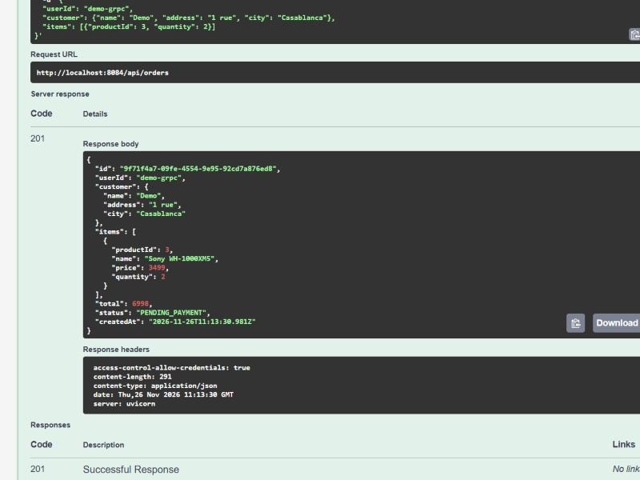
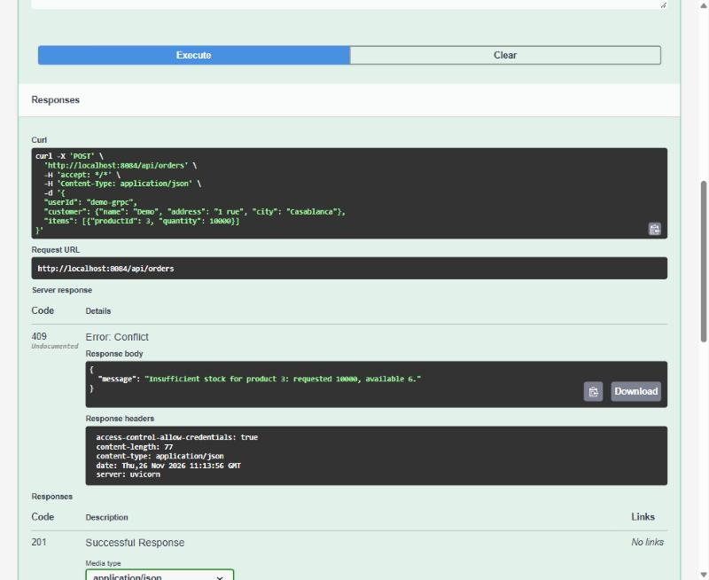
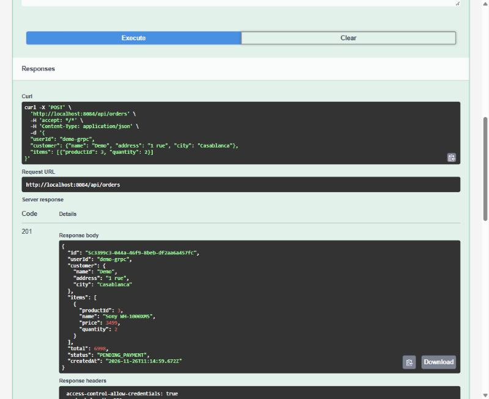

# LAB 4 — Scénario 1 (gRPC) : partie client Orders et benchmark

**Responsables du scénario 1 :** Youssef et Taha
**Implémentation :** contrat, serveur et client gRPC livrés par Youssef dans la PR #11 (`proto/`, `services/inventory/grpc_server.py`, `services/orders/inventory_client.py`).
**Ce document (Taha) :** analyse du côté client Orders, tests sur les services réels et benchmark REST vs gRPC.
Analyse Q1, décision Q4 et côté serveur : voir [`proto/README.md`](../../proto/README.md).

## 1. Services concernés

| Service | Rôle dans le scénario | Ports |
|---|---|---|
| Orders | **Client gRPC** : vérifie et réserve le stock avant d'enregistrer une commande | REST 8084 |
| Inventory | Serveur gRPC (partie de Youssef), même base SQLite que son API REST | REST 8083, gRPC 50051 |
| Catalog | Fournit les prix (REST, inchangé) | REST 8082 |

Le frontend continue d'appeler Orders en REST (`POST /api/orders`). Seul l'appel interne Orders → Inventory passe en gRPC, et l'API REST d'Orders ne change pas.

## 2. Contrat utilisé côté client

Le contrat est [`proto/inventory.proto`](../../proto/inventory.proto) (package `inventory`, service `InventoryService`). Le code client est généré dans `services/orders/inventory_pb2.py` et `inventory_pb2_grpc.py` (`python proto/generate.py`).

| RPC appelée par Orders | Quand | Requête → Réponse |
|---|---|---|
| `CheckAvailability` | création d'une commande, une fois par produit, en parallèle | `AvailabilityRequest{productId, quantity}` → `AvailabilityResponse{available, availableQuantity}` |
| `ReserveStock` | création, après la vérification | `StockRequest{items[]}` → `StockResponse{success}` (atomique : tout ou rien) |
| `ReleaseStock` | annulation, ou compensation si la commande ne peut pas être enregistrée | `StockRequest{items[]}` → `StockResponse{success}` |

**Traduction des erreurs gRPC en réponses HTTP d'Orders** (le frontend reçoit toujours `{"message": ...}`) :

| Code gRPC | HTTP | Cas |
|---|---|---|
| `FAILED_PRECONDITION` | 409 | stock insuffisant au moment de la réservation |
| `INVALID_ARGUMENT` | 400 | quantité ou identifiant invalide |
| `NOT_FOUND` | 404 | produit inconnu |
| `UNAVAILABLE` | 503 | Inventory injoignable (connexion refusée) |
| `DEADLINE_EXCEEDED` | 504 | Inventory ne répond pas dans le délai |
| autre | 502 | erreur inattendue (journalisée) |

Si `CheckAvailability` répond `available=false`, Orders renvoie directement **409** avec la quantité disponible, sans appeler `ReserveStock`.

## 3. Implémentation et configuration

**Conception du client** (`GrpcInventoryGateway`)
- **Un seul canal** `grpc.aio` (HTTP/2) est créé au démarrage d'Orders, puis réutilisé par toutes les requêtes. Il est fermé à l'arrêt de l'application.
- **Deadline** de 2 s sur chaque appel : une panne d'Inventory ne bloque jamais Orders plus longtemps que ce délai.
- **Retry** : un seul, après 200 ms, uniquement pour `CheckAvailability` sur `UNAVAILABLE`, car c'est une lecture. `ReserveStock` et `ReleaseStock` modifient le stock, donc ils ne sont jamais rejoués automatiquement (pas de double réservation).
- La même interface (`ensure_available`, `reserve`, `release`) existe en REST (`RestInventoryGateway`), ce qui permet de revenir à l'ancien transport sans toucher au reste d'Orders.

**Variables d'environnement d'Orders**

| Variable | Défaut | Rôle |
|---|---|---|
| `INVENTORY_TRANSPORT` | `grpc` | `grpc` ou `rest` (repli et comparaison) |
| `INVENTORY_GRPC_ADDR` | `127.0.0.1:50051` | adresse du serveur gRPC |
| `INVENTORY_GRPC_TIMEOUT` | `2.0` | deadline par appel, en secondes |
| `INVENTORY_URL` | `http://127.0.0.1:8083` | utilisé seulement en mode `rest` |

Au démarrage, Orders journalise le transport choisi : `Orders -> Inventory transport: grpc`.

## 4. Tests

### 4.1 Tests automatisés

| Suite | Résultat (25/11/2026) |
|---|---|
| `services/orders/tests` (dont `test_inventory_grpc.py` : commande via gRPC, refus sans réservation, Inventory arrêté) | **9 passed** |
| `services/inventory/tests` (dont `test_grpc_server.py`, partie de Youssef) | **18 passed** |

### 4.2 Scénarios sur les services réels

Sortie complète : [`docs/lab4-evidence/grpc/scenarios.txt`](../lab4-evidence/grpc/scenarios.txt) et [`demo_grpc_output.txt`](../lab4-evidence/grpc/demo_grpc_output.txt).

| Scénario | Résultat obtenu | Attendu |
|---|---|---|
| Commande acceptée : 2 × produit 3 | `201`, statut `PENDING_PAYMENT`, stock 8 → 6 (`ReserveStock`) | ✔ |
| Annulation de cette commande | `200`, `CANCELLED`, stock revenu à 8 (`ReleaseStock`) | ✔ |
| Commande refusée : 10000 × produit 3 | `409` « Insufficient stock for product 3: requested 10000, available 6. », rien n'est réservé | ✔ |
| Inventory arrêté | `504` « The inventory service timed out. » en 2,2 s, Orders reste `UP`, aucune commande enregistrée | ✔ (pas de crash) |
| Inventory redémarré | commande suivante `201` en 142 ms, le canal se reconnecte seul | ✔ |

> **Pourquoi 504 et pas 503 quand Inventory est arrêté ?** Sous Windows, une connexion vers un port fermé n'est refusée qu'après environ 2 s, à cause des retransmissions TCP. Le log Kafka d'Orders le montre aussi : `Connect to 127.0.0.1:9092 failed ... after 2053ms`. La deadline de 2 s expire donc avant que gRPC reçoive le refus, et l'appel finit en `DEADLINE_EXCEEDED` → 504. Sur un système qui refuse la connexion immédiatement, on obtient `UNAVAILABLE` → 503. Dans les deux cas, l'objectif du guide est atteint : erreur claire et rapide, sans crash ni commande fantôme.

**Captures d'écran** (Swagger d'Orders, `POST /api/orders`, services réels, 26/11/2026) :

| Commande acceptée → `201` | Stock insuffisant → `409` |
|---|---|
|  |  |
| **Inventory arrêté → `504`** | **Inventory redémarré → `201`** |
|  |  |

Pendant la panne, aucune commande n'a été enregistrée : `GET /api/orders?userId=demo-grpc` ne renvoie que la commande du premier scénario ([capture](../lab4-evidence/grpc/screenshots/3b-aucune-commande-pendant-la-panne.jpg)).

Comparaison de bout en bout via `POST /api/orders` (gRPC contre REST) : voir [`lab4-grpc-server-youssef.md`](lab4-grpc-server-youssef.md) § 5.

## 5. Benchmark REST vs gRPC

**Protocole :** `python proto/demo_grpc.py --bench 1000`. On fait 1000 vérifications de disponibilité du produit 3 par protocole, après 20 appels de chauffe. REST utilise un client `httpx` en keep-alive (le cas le plus favorable pour REST), et gRPC un canal persistant. Tout tourne en local sur la même machine (Windows 10, Python 3.10). Trois exécutions ont été faites.

| Exécution | REST moyenne | REST médiane | REST p95 | gRPC moyenne | gRPC médiane | gRPC p95 | Gain |
|---|---|---|---|---|---|---|---|
| 1 | 4,24 ms | 3,79 ms | 6,19 ms | 2,51 ms | 2,41 ms | 3,20 ms | 1,7× |
| 2 | 4,00 ms | 3,75 ms | 5,21 ms | 2,50 ms | 2,41 ms | 3,21 ms | 1,6× |
| 3 | 4,62 ms | 4,00 ms | 8,06 ms | 2,51 ms | 2,42 ms | 3,08 ms | 1,8× |
| **Moyenne** | **4,29 ms** | **3,85 ms** | **6,49 ms** | **2,51 ms** | **2,41 ms** | **3,16 ms** | **1,7×** |

| Taille requête + réponse | REST (JSON) | gRPC (Protobuf) |
|---|---|---|
| Octets | 62 | **9** (≈ 7× plus petit) |

**Interprétation**
- gRPC est environ **1,7 fois plus rapide** en moyenne, et ses messages sont **7 fois plus petits**.
- gRPC est surtout **plus régulier** : son p95 reste vers 3,2 ms, alors que celui de REST varie de 5,2 à 8,1 ms. La sérialisation binaire et la connexion HTTP/2 persistante évitent le parsing JSON et une partie du coût HTTP/1.1.
- Ces mesures sont faites en local, sur une seule machine et avec un seul client. Sur un vrai réseau et sous charge concurrente, l'écart devrait augmenter, car le multiplexage HTTP/2 (plusieurs appels sur une connexion) et la taille des messages pèsent davantage.

## 6. Conclusion

Orders obtient toujours une réponse **synchrone** d'Inventory avant de confirmer une commande, ce qu'un broker ne permettrait pas. Il l'obtient maintenant avec un contrat typé partagé, des messages plus petits, une latence plus faible et plus stable, et une gestion explicite des pannes (deadline, retry limité aux lectures, codes d'erreur traduits). L'API REST vue par le frontend est restée identique.
