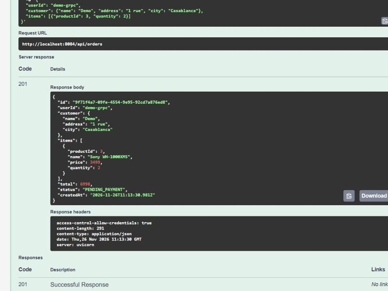
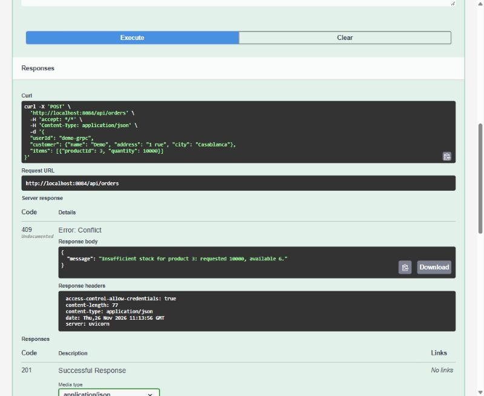
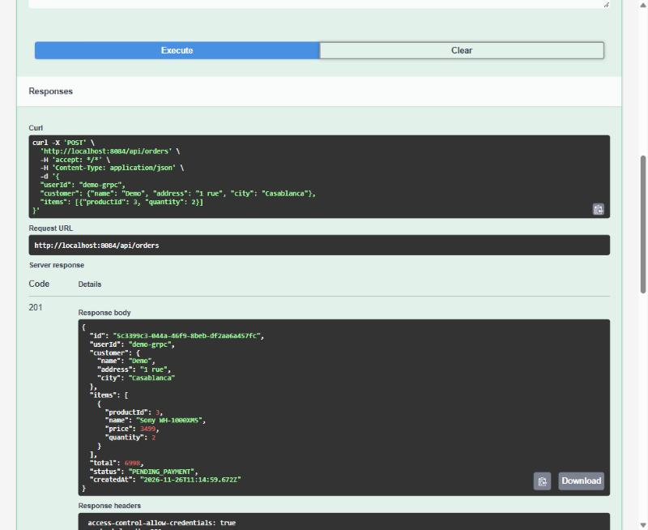

# LAB 4 — Scénario 1 (gRPC) : contrat, serveur Inventory et vérification de bout en bout

**Auteur :** Youssef · **Binôme :** Taha (côté client Orders et benchmark : [`lab4-grpc-client-taha.md`](lab4-grpc-client-taha.md))
**Analyse Q1 et décision Q4 :** [`proto/README.md`](../../proto/README.md)

## 1. Services concernés et responsabilités

| Service | Rôle | Responsabilité dans ce scénario |
|---|---|---|
| Inventory | **Serveur gRPC** (port 50051) et API REST (port 8083) | Seul propriétaire du stock. Il vérifie, réserve de façon atomique et libère le stock. |
| Orders | **Client gRPC** | Pour chaque commande, il demande à Inventory la disponibilité puis la réservation, et la libération en cas d'annulation. Il ne lit jamais la base d'Inventory directement. |

## 2. Contrat : [`proto/inventory.proto`](../../proto/inventory.proto)

```proto
service InventoryService {
  rpc CheckAvailability (AvailabilityRequest) returns (AvailabilityResponse);
  rpc ReserveStock      (StockRequest)        returns (StockResponse);
  rpc ReleaseStock      (StockRequest)        returns (StockResponse);
}
message AvailabilityRequest  { string productId = 1; int32 quantity = 2; }
message AvailabilityResponse { bool available = 1; int32 availableQuantity = 2; }
message StockItem            { string productId = 1; int32 quantity = 2; }
message StockRequest         { repeated StockItem items = 1; }
message StockResponse        { bool success = 1; }
```

`CheckAvailability` reprend exactement le contrat du support *H2*. Les deux autres RPC couvrent les appels qu'Orders faisait déjà en REST (`reserve` / `release`).

| RPC | Succès | Erreurs gRPC |
|---|---|---|
| `CheckAvailability` | `available` et `availableQuantity` (stock actuel) | `INVALID_ARGUMENT` : id non numérique ou ≤ 0, quantité ≤ 0 · `NOT_FOUND` : produit inconnu |
| `ReserveStock` | `success: true`. Toutes les lignes sont réservées, ou aucune. Les lignes en double sont additionnées. | `INVALID_ARGUMENT` : liste vide, id ou quantité invalide · `FAILED_PRECONDITION` : stock insuffisant ou produit inconnu (rien n'est modifié) |
| `ReleaseStock` | `success: true` | `INVALID_ARGUMENT` · `NOT_FOUND` : produit inconnu |

Le code Python est **généré** depuis le contrat (`python proto/generate.py`) dans les deux services, et n'est jamais modifié à la main.

## 3. Configuration

| Élément | Valeur |
|---|---|
| Port gRPC | `50051`, modifiable par `INVENTORY_GRPC_PORT` |
| Démarrage | automatique avec `python -m uvicorn main:app --port 8083` (REST et gRPC dans le même processus). `python grpc_server.py` lance le gRPC seul. |
| Désactivation | `INVENTORY_GRPC_ENABLED=0`, si l'on veut le REST seul |
| Transport | `insecure` (texte en clair) en local, comme dans le support. TLS serait nécessaire en production. |
| Pool de traitement | `ThreadPoolExecutor(max_workers=10)` |
| Dépendances | `grpcio>=1.82.1`, `protobuf>=7.35` (`services/inventory/requirements.txt`) |

## 4. Implémentation du serveur

- **[`stock_logic.py`](../../services/inventory/stock_logic.py)** : les règles métier du stock (`get_stock`, `is_available`, `reserve`, `release`). Les **deux** interfaces, REST et gRPC, appellent ces mêmes fonctions, comme l'exige `LAB4_CONTRACTS.md` § 1. La réservation et la libération se font dans une transaction SQLite `BEGIN IMMEDIATE` : tout est vérifié avant toute modification.
- **[`grpc_server.py`](../../services/inventory/grpc_server.py)** : `InventoryServicer` valide les messages Protobuf, appelle `stock_logic` et convertit les erreurs métier en codes gRPC (`ProductNotFound` → `NOT_FOUND`, `InsufficientStock` → `FAILED_PRECONDITION`, erreur SQLite → `INTERNAL`). Chaque appel est journalisé dans la console d'Inventory.
- **[`main.py`](../../services/inventory/main.py)** : il démarre le serveur gRPC au lancement de l'application et l'arrête à la fermeture. Les endpoints REST utilisent maintenant `stock_logic`, avec les **mêmes** réponses et codes HTTP qu'avant (les 8 tests REST existants passent).

## 5. Tests et vérification

### 5.1 Tests automatisés (26/11/2026)

| Suite | Contenu | Résultat |
|---|---|---|
| `services/inventory/tests/test_grpc_server.py` | Scénarios du support (stock suffisant / insuffisant, produit 999, quantité 0), id invalide, réservation atomique, lignes en double, libération, liste vide, **même stock vu en REST et en gRPC** | 11 passed |
| `services/inventory/tests/test_inventory.py` | API REST existante | 8 passed |
| `services/orders/tests` | Dont le client gRPC (partie de Taha) | 9 passed |

### 5.2 Services réels : captures

Swagger d'Orders, `POST /api/orders`, avec Catalog, Inventory et Orders lancés en local :

| Commande acceptée → `201` | Stock insuffisant → `409` |
|---|---|
|  |  |
| **Inventory arrêté → `504`** | **Inventory redémarré → `201`** |
|  |  |

- Pendant la panne, **aucune commande n'est enregistrée** ([capture](../lab4-evidence/grpc/screenshots/3b-aucune-commande-pendant-la-panne.jpg)).
- Console d'Inventory pendant ces captures : [`inventory_server_log.txt`](../lab4-evidence/grpc/inventory_server_log.txt). Pour la commande refusée, on voit `CheckAvailability`, mais **aucun** `ReserveStock`.

### 5.3 Comparaison de bout en bout via `POST /api/orders` (item optionnel de l'issue #15)

**Protocole :** deux instances d'Orders tournent sur les mêmes Catalog et Inventory :
- `8084` en gRPC ;
- `8094` avec `INVENTORY_TRANSPORT=rest`.

Pour chaque transport, on lance 200 commandes (création puis annulation), après 10 de chauffe. Le script est `proto/bench_orders_e2e.py`, et la sortie complète est dans [`bench_orders_e2e.txt`](../lab4-evidence/grpc/bench_orders_e2e.txt). Trois exécutions ont été faites.

| Exécution | gRPC moyenne | REST moyenne | Écart |
|---|---|---|---|
| 1 | 46,22 ms | 39,55 ms | REST plus rapide de 6,7 ms |
| 2 | 43,77 ms | 40,92 ms | REST plus rapide de 2,9 ms |
| 3 | 49,06 ms | 41,81 ms | REST plus rapide de 7,3 ms |

**Interprétation honnête :**
- De bout en bout, le chemin gRPC n'est **pas** plus rapide. Il est même un peu plus lent, de 3 à 7 ms. Deux raisons :
  1. Le chemin gRPC fait **deux** appels par commande (`CheckAvailability`, comme le demande le support, puis `ReserveStock`). Le chemin REST n'en fait **qu'un** (`reserve`, qui vérifie déjà le stock).
  2. Le temps d'une commande, environ 40 ms, est dominé par les écritures SQLite (Orders et Inventory) et par l'appel à Catalog. Le transport Orders → Inventory n'en représente que quelques millisecondes.
- **Appel par appel**, gRPC reste plus rapide et plus régulier (environ 1,5 à 1,7 fois, avec des messages 7 fois plus petits : voir le benchmark de Taha). Le gain de gRPC porte sur le **coût de chaque échange**, qui compte quand les vérifications sont **fréquentes**, comme dans l'énoncé du scénario 1. Ce gain n'est pas visible sur une requête dominée par la base de données.
- Piste d'amélioration : supprimer l'appel `CheckAvailability` avant `ReserveStock` (la réservation est déjà atomique et refuse le stock insuffisant) ramènerait le chemin gRPC à un seul appel. Nous l'avons gardé parce que le support demande explicitement qu'Orders appelle `CheckAvailability` avant de continuer, et parce qu'il permet de renvoyer au client la quantité disponible.

## 6. Conclusion

Inventory expose son stock en gRPC à partir d'un contrat typé et partagé, sans dupliquer les règles métier de l'API REST. Les erreurs sont signalées avec les codes gRPC standard, et la réservation reste atomique. Tous les scénarios du support (étapes 4 et 6) sont vérifiés, par des tests automatisés et sur les services réels.
